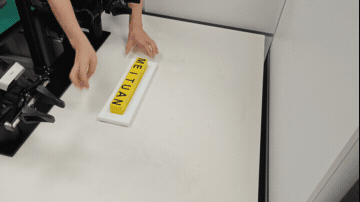
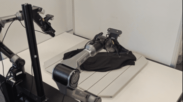
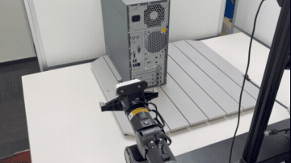
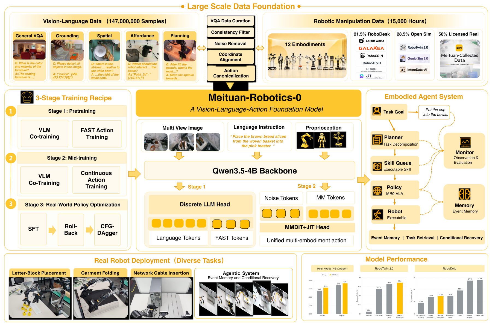

<h1 align="center">Meituan-Robotics-0</h1>

<strong>A Vision-Language-Action Foundation Model for Desktop Manipulation</strong>

Meituan Robotics

  
  
  

  <a href="#overview">Overview</a> ·
  <a href="#models">Models</a> ·
  <a href="#simulation-benchmarks">Simulation</a> ·
  <a href="GETTING_STARTED.md">Documentation</a> ·
  <a href="#quick-start">Quick start</a>

## 🤖 Real-world manipulation

| Letter block placement | Garment folding | Network cable insertion |
| :---: | :---: | :---: |
|  |  |  |

*Demonstrations shown at 6×, 6×, and 3× speed, respectively.*

## 🌟 Overview

| Learn representations | Transfer to control | Adapt to a task suite |
| :--- | :--- | :--- |
| **Stage 1 · FAST** | **Stage 2 · MMDiT** | **Downstream policies** |
| Discrete action-token prediction with vision-language co-training. | Continuous flow-matching actions, initialized from a pretrained FAST representation. | Adapt pretrained VLA models to downstream manipulation tasks. |

- 🌐 **Large-scale multimodal pretraining.** Combine **147M vision-language samples** with **15,060 hours of robot trajectories** spanning **12 embodiments**, bringing visual, language, and action supervision into a shared training pipeline.
- ⚡ **FAST action representation learning.** Stage1-FAST learns discrete action-token prediction alongside vision-language co-training, connecting multimodal representations to robot behavior.
- 🧠 **MMDiT continuous control.** Stage2-MMDiT transfers the pretrained FAST representation into a continuous flow-matching action model, bridging action-token learning and continuous robot control.
- 🎯 **Downstream task adaptation.** Adapt pretrained VLA models to downstream manipulation tasks, with real-world demonstrations covering letter block placement, garment folding, and network cable insertion.
- 📊 **Simulation evaluation and deployment.** Evaluate on **RoboTwin**, **RoboDojo**, and **RoboCasa365**, with MR0-RoboTwin reaching **93.22%** clean and **93.88%** randomized success rates. The repository includes training configurations, a RoboTwin evaluation interface, and an OpenPI-compatible policy server.

## 📦 Models

| Model / Data | Download |
| :--- | :--- |
| **Meituan-Robotics-0** | [Hugging Face](https://huggingface.co/MeituanRobotics/Meituan-Robotics-0) |
| **Meituan-Robotics-0-RoboTwin** | [Hugging Face](https://huggingface.co/MeituanRobotics/Meituan-Robotics-0-RoboTwin) |
| **Meituan-Robotics-0-RoboDojo** | [Hugging Face](https://huggingface.co/MeituanRobotics/Meituan-Robotics-0-RoboDojo) |
| **Meituan-Robotics-0-RoboCasa365** | [Hugging Face](https://huggingface.co/MeituanRobotics/Meituan-Robotics-0-RoboCasa365) |
| **RoboDesk (Pretraining Data)** | [Hugging Face](https://huggingface.co/datasets/MeituanRobotics/RoboDesk) |

## 🎯 Simulation benchmarks

### RoboTwin

**MR0-RoboTwin** is evaluated on **50 tasks × 100 episodes per task**, with unseen instructions:

| Model | `demo_clean` SR | `demo_randomized` SR |
| :--- | ---: | ---: |
| **MR0-RoboTwin** | **93.22%** | **93.88%** |

### RoboDojo

| Reported model | Average success rate | Protocol |
| :--- | ---: | :--- |
| **MR0** | **14.63%** | Equal-weight average of two complete evaluations of the same checkpoint. |

### RoboCasa365

| Model | Success rate (SR) |
| :--- | ---: |
| **Meituan-Robotics-0-RoboCasa365** | **55.0%** |

---

## 🚀 Quick Start

See the [Getting Started guide](GETTING_STARTED.md) for setup and runnable commands.

## 📜 Citation and acknowledgements

Technical report: [*Meituan-Robotics-0: A Vision-Language-Action Foundation Model for Desktop Manipulation*](https://arxiv.org/abs/2611.08577) (Meituan Robotics Team, 2026), arXiv:2611.08577.

MR0 builds on the StarVLA training and deployment stack. For the underlying software, see [CITATION.cff](CITATION.cff). We thank the [StarVLA](https://github.com/starVLA/starVLA), [Qwen](https://github.com/QwenLM), [RoboTwin](https://github.com/RoboTwin-Platform/RoboTwin), and [RoboDojo](https://github.com/RoboDojo-Benchmark/RoboDojo) communities.

## ⚖️ License

See [LICENSE](LICENSE) for the code license and the linked Hugging Face model and dataset cards for their respective licenses and release details.
